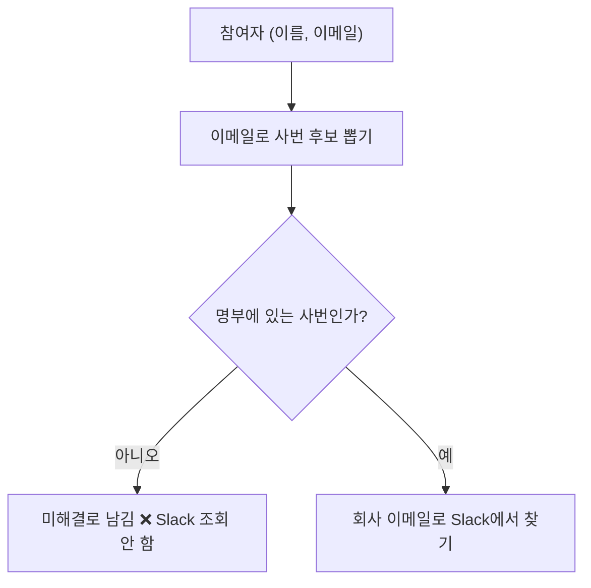

# Flow Analysis Doc

A flow-analysis doc is an **as-built walkthrough** of ONE subsystem that answers two questions at once for every step: **"what happens (concept)"** and **"where in the code (File:Line)."** It is readable by developers and non-developers alike, and it is part explainer, part audit — the value that code alone cannot give is concentrated in the **gotchas / 주의·관찰 포인트** section (dead code, footguns, boundaries, required operational steps).

Do not write a prose summary of the code. Write a navigable map: diagrams a newcomer can follow, tables a developer can jump from, and findings a maintainer can trust.

## Three non-negotiables (skip one and the doc is worse than nothing)

1. **Ground EVERY File:Line in a first-hand read.** Never cite a line number from memory, from a summary, or from a plan written before the code. Open the file. A flow doc's entire value is that its pointers are correct; a stale `:142` actively misleads. Re-verify after any code move.
2. **Read a project exemplar first.** If the repo already has a flow / analysis / "execution trace" doc, read it before writing a line — match its structure, depth, section names, callout style, and **language**. You are extending a house style, not inventing one.
3. **Verify load-bearing claims against reality — and SHOW the check.** Before you write "this is dead code" / "read in only one place" / "always empty" / "never reached", prove it: run the grep, the DB query, the trace. Put the command and its result in the doc as a 🔬 실측 (verification) callout. An unverified audit claim is a liability with your name on it.

## Process

1. **Calibrate.** Read the exemplar + the request. Fix scope to ONE subsystem/flow — resist documenting the whole system.
2. **Read the source first-hand.** The orchestrator, its ports/callees, the data types, the wiring/construction, and the *consumer* of whatever it produces. Collect exact File:Line as you read.
2b. **Harvest the paper trail, not just the code.** Read the feature's plan / review / spec / design docs alongside the source. Accepted boundaries, rejected alternatives (and *why* the rejected path is now dead code), safe-deferred work, and invariant/decision IDs (`INV-*`, `R*`, `L*`, `D*`, spec §refs) live THERE, not in the code — mine them for the gotchas section and cite them (e.g. `plan §10 #9`, `M6 §4a`). Half of a strong gotchas list is *why it was built this way*, which the code physically cannot tell you.
3. **Draft the skeleton** (below), filling diagrams and tables from the reads.
4. **Run the 실측 checks**; fold results in as callouts. Let findings drive the gotchas section.
5. **Place, name, index** (repo-knowledge-map). **Verify** (RENDER every mermaid block — see "Before done"; anchors; spot-checked lines).

## Structure (skeleton — adapt section names to the project's language & house style)

Order is broad → narrow → analytical:

- **Title + intro blockquote** — one paragraph: what this doc is, the analysis target (the files), and pointers to the spec/contract that says *why*.
- **목차 / TOC** — anchor links to every section.
- **0. 한눈에 보기 (bird's-eye, for non-developers)** — what the feature does in plain words; a "key concepts" table; when/how it runs; any before→after or A-vs-B contrast table.
- **1. Overall flow** — a `classDiagram` (structure: types + ports + impls), a `sequenceDiagram` (the primary path *with its key branches* — use `loop`/`alt`/`Note over`), and a step-summary table with File:Line covering EVERY major step end-to-end (route → result) — the code's table of contents.
- **2..N. Per-phase sections** — each phase gets: one plain-language sentence, a `flowchart` (concept nodes), a File:Line table (the code mechanics), and callouts for the subtle parts.
- **A decision / state summary table** — a **multi-condition matrix**: one column per decision input (e.g. `resolved? | employeeID | member-match | Slack`), then the outcome, then File:Line — NOT a flat two-column list. Each row = one reachable path a maintainer can check against the code.
- **Data model** — the persisted / cross-module types, field-by-field, with 출처 (source File:Line).
- **Human scenarios** — 3–5 "what happens to person X" narratives (new hire, transfer, edge case) for non-devs. **Write them person-first, not as a code trace:** open each with the plain-language situation ("팀 X에 진단이 나왔다 — 누구에게 알려야 하나?"), walk the decision in plain steps that say *why* each branch is taken or skipped, and end with what it means for a real person ("→ 팀장 김도현에게 갈 후보가 된다"). The exact struct / return value is a supporting **결과 / result line at the end**, NOT the narrative itself — a section built from `chain[0]={Code:…,LeadSource:…}` dumps and `fn("arg")` calls is a *developer trace mislabeled "non-dev"* (the concrete failure this rule exists to stop). Ground each in **real data shapes** — actual field names and representative values from the real collections (`username=…, publicEmail=…@company.com`), not an abstract "user A"; aim for one scenario per branch of the decision table.
- **주의·관찰 포인트 / gotchas** — THE analytical heart. Footguns, dead/unreachable code (proven), accepted boundaries, ordering hazards, required operational steps, latent collisions. What a reader cannot get from reading the code. **Source these as much from the design/plan/review history (step 2b) as from the code**, and cross-link each subtle callout to its gotcha entry and back.
- **용어집 / glossary** + **참고 파일 / reference files** table.

## Diagram rules (this is where flow docs usually go wrong)

- **Flow diagrams (flowchart / sequence): concept-first, plain language in the nodes.** Put `① 참여자 모으기 (작성자·담당자·리뷰어만)` in the node — NOT `Stage1 $project: ...roles[]=(u,e)`. The code mechanics (`$project`/`$group`/`$lookup`, function names, field syntax) go in the **File:Line table beneath** the diagram, never in the node. A reader skims the diagram for shape and drops to the table for precision.
- **classDiagram MAY show type/method names** — it is a structure map; that is its job. Don't Korean-ize a class diagram.
- **classDiagram members are strictly parsed — one malformed member crashes the WHOLE diagram, not just that line.** Every member needs an identifier *before* the `(`: write `Fingerprint(fact, key) string`, NEVER `(fact, key) to string` — a member line starting with `(` makes mermaid read an `undefined` method name and throw `Cannot read properties of undefined (reading 'startsWith')`, and the viewer shows a broken diagram. Also inside `class { … }` bodies: avoid prefix-array types (`[]Fact` → use `List~Fact~` or postfix `Fact[]`), and keep `:` colons / `File:Line` OUT of `<<stereotype>>` blocks (File:Line belongs in the table beneath, never in a node — see Readability). When unsure a member is well-formed, render it (see "Before done").
- **Flag dead / unreachable code visually, but only after proving it (실측):** a red-dashed node for truly-dead code (`classDef dead fill:#fdecea,stroke:#c0392b,stroke-width:2px,stroke-dasharray:6 4,color:#c0392b; class X dead;`), and a marker (e.g. 💤) for a *reached-but-unreachable branch*. Explain the cause and link to the gotcha entry.
- Keep node labels short; use `<br/>` for a second line, not a paragraph.

## Callout vocabulary (emoji = at-a-glance meaning)

🔑 design principle / the load-bearing rule · ⚠️ warning or hazard · 🔴 dead code (proven) · 💤 unreachable branch · 🧩 subtle nuance · 📌 note · ℹ️ contrast / aside · 🔒 invariant · 🗑️ soft-delete / cleanup · 💡 tip · 🛑 abort / stop · ❌ (in a diagram node) this path does NOT happen · 🔬 실측 (verification — show the command + result). This list is representative — add what the doc needs.

## Worked micro-example — one phase, fully assembled

The skeleton lists the sections; this pins the *shape of one section* so an agent with no exemplar still hits the format (concept diagram → File:Line table → callouts). Match your project's language — this uses the Korean house style.

````markdown
### 3-3. 참여자 대조 (reconcile)

각 MR 참여자의 이메일로 사번 후보를 뽑아, **명부에 실제로 있는 사번일 때만** 통과시킵니다.



| 단계 | File:Line | 설명 |
|------|-----------|------|
| 사번 유도 | `sync.go:197` | `extractEmployeeID(publicEmail, username)` |
| 명부 대조 | `:201-210` | `byEmp[candidate]` 매칭만 통과; miss → NotFound(**Slack 없음**) |
| 회사 이메일 | `:213-216` | `member.Email` 또는 `candidate@domain` |

🔑 **명부에 없는 사번은 Slack에 가지 않는다** (`:201-210`) — 존재하지 않는 사번 조회는 낭비 (§gotchas 참조).

🔬 **실측:** `grep -rin "publicEmail" internal/ --include="*.go" | grep -v _test.go` → 실행 코드가 읽는 곳은 `mrContributorReader.go` 한 곳뿐(나머지는 주석) → INV-PII-1 성립.
````

The load-bearing moves to reproduce (not just the section list): diagram nodes are **plain concepts** (`$group`/`$project` never appear in a node); exact lines + identifiers live in the **table** (file anchored once as `sync.go:197`, then bare `:201-210`); the two callouts carry the **rule** (🔑) and its **proof** (🔬).

## Readability

- **Concept-first, match the project's doc language.** Lead with the plain-language concept; keep the code identifier as support, not the headline.
- **Don't leave untranslated jargon in reader-facing prose** — gloss on first use (dedup → 중복 제거, coalesce → 대표 이메일 선택, pacing → 속도 조절). This includes **terms the doc itself coins**: a structural metaphor — "ladder/rung", "chain", "fence" — reads as jargon the first time, so name it in the reader's language and gloss it once ("리더 사다리 — 리더를 찾는 우선순위 단계"; refer to a step as "1순위 단계", never a bare English "rung" dropped into Korean prose). Never leave a bare foreign-language word in reader-facing prose when the doc's language has one. Code identifiers stay verbatim **in tables** — that is where developers look and precision matters.
- Division of labor: the **table** carries precision (File:Line, exact identifiers); the **diagram + prose** carry comprehension. Don't blur them.
- **File:Line table convention:** anchor a file once per table (e.g. `sync.go:197`), then use bare `:line` / `:line-range` for later rows in that same table. Use exact multi-line ranges for multi-line logic (`sync.go:201-210`), not a single line.

## Placement, naming, index (repo-knowledge-map)

- **Co-locate** with the subsystem's other docs — not an orphan folder. If the code you analyze is documented under `docs/x/y/`, the analysis belongs near those siblings, discovered by the same reader.
- **Match the local naming convention exactly** — camelCase `_v1`? kebab-case? Korean? Look at the neighbors, don't guess. Add front-matter (title, owner, status, last-verified) by default — drop it only if the sibling docs deliberately omit it.
- **Link it from the nearest maintained index**, under the right genre subsection (an "execution trace" / "flow analysis" category if one exists; create one only if the genre is new). A doc no index points to is invisible.

## Before done — verify

- **Every mermaid diagram actually RENDERS — not just "fences balanced."** Balanced fences are necessary but NOT sufficient: a well-fenced block can still crash the viewer (a malformed classDiagram member throws `Cannot read properties of undefined (reading 'startsWith')`, and mermaid then renders NOTHING). So render each block before declaring done — extract every ```` ```mermaid ```` block to a `.mmd` file and run `npx -y -p @mermaid-js/mermaid-cli mmdc -i block.mmd -o block.svg` (first run downloads the CLI + a headless browser, ~1–2 min; it works headless in a sandbox). An SVG written = passes; a `TypeError`/parse error on stderr = fix and re-render. This is a REVIEW gate too: a reviewer who only eyeballs the source (or checks fence balance) will pass a diagram that crashes for the user — render them yourself. If mmdc genuinely cannot run (no network), say so explicitly rather than silently downgrading to a fence check.
- Every internal anchor link resolves to a heading (TOC + cross-refs) — a renamed heading silently breaks inbound links.
- Spot-check 3–5 File:Line pointers against the real files.
- Every audit claim (dead code, "only place", "always X", "never reached") has a shown 🔬 실측 backing it.
- Every phase has its OWN full section (sentence + diagram + table + callouts) — phases not collapsed.
- The human-scenarios section reads **person-first** (situation → plain steps with *why* → human outcome), not struct dumps / `fn("arg")` traces; the exact values sit in a trailing 결과/result line, not as the narrative.
- **No un-glossed jargon or bare foreign-language term in reader-facing prose** (0. bird's-eye, human scenarios, callout prose) — including self-coined metaphors ("rung"/"ladder"/"fence"). Grep the reader-facing sections for stray English terms before finishing.
- The gotchas list isn't cut short: a real subsystem yields ~8–12 observations; a 3-entry gotchas section means you stopped reading.
